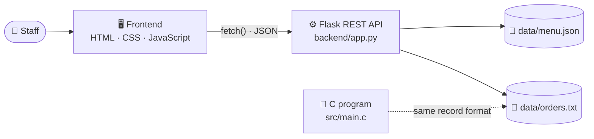
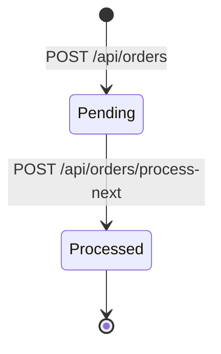
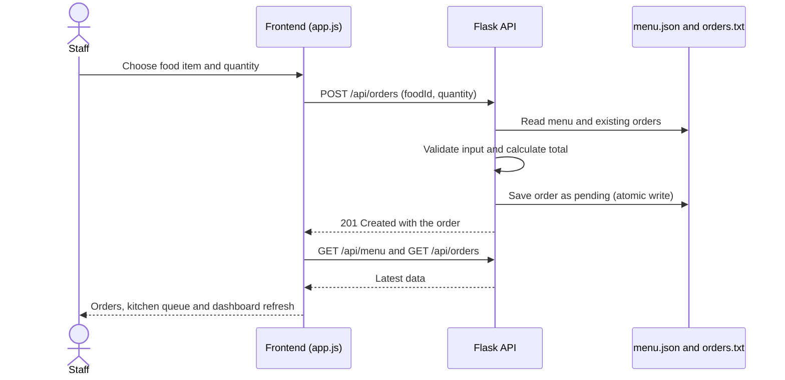
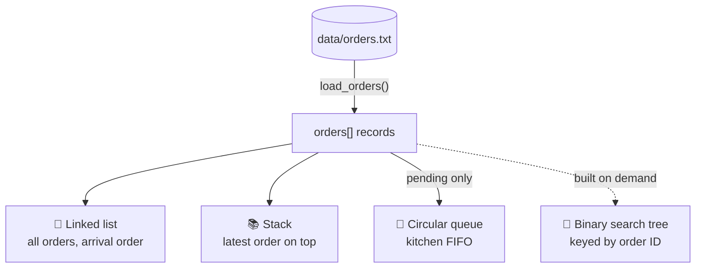

<div align="center">


<a href="https://github.com/atul-nandanwar/SmartServe-Restaurant-Management-System1">
  
</a>

<br>


**[Overview](#-the-idea)** · **[Architecture](#-architecture)** · **[Features](#-features)** · **[Screenshots](#-screenshots)** · **[DSA](#-dsa-deep-dive)** · **[Quick Start](#-quick-start-windows)** · **[API](#-api-reference)** · **[Team](#-team)**

</div>

---

## 💡 The Idea

A busy restaurant is full of data-structure problems. **SmartServe** takes those real situations and builds them twice: as a working **web app** you can click through, and as a **C program** where the data structures are written from scratch.

| In the restaurant | Data structure / algorithm | Where |
|---|---|---|
| Orders are cooked in the order they arrive | **Queue (FIFO)** | Kitchen queue |
| "What was the latest order?" | **Stack (LIFO)** | Recent-order stack |
| Every order chained in arrival order | **Linked list** | Order chain |
| "Find order #5, fast" | **Binary search tree** + search | Order lookup |
| Menu from cheapest to costliest | **Sorting** | Sort menu by price |
| Orders must survive a restart | **File handling** | `orders.txt` |

> [!NOTE]
> This is a student project that runs on your own computer. It is **not deployed online**, and the payment options are a **demonstration only** (no real money moves and no payment gateway is connected).

---

## 🧩 Architecture



> [!IMPORTANT]
> The C program and the web app are **independent**. Flask does not call the C code; they only share the `orders.txt` file format.

### Life of an order



### What happens when you place an order



### What the C program builds when it starts



---

## ✨ Features

<table>
  <tr>
    <td width="33%" valign="top">
      <h3>📊 Dashboard</h3>
      Total, pending and processed orders, order value before GST, recent orders and quick actions.
    </td>
    <td width="33%" valign="top">
      <h3>🍛 Food Menu</h3>
      View the menu and <b>add new food items</b>. Names are checked for duplicates and saved to <code>menu.json</code>.
    </td>
    <td width="33%" valign="top">
      <h3>🧾 Orders</h3>
      Pick an item and a quantity. The <b>server calculates the total</b> and saves the order.
    </td>
  </tr>
  <tr>
    <td width="33%" valign="top">
      <h3>👨‍🍳 Kitchen Queue</h3>
      Pending orders shown with FIFO position. <b>Process next order</b> serves the oldest one first.
    </td>
    <td width="33%" valign="top">
      <h3>💳 Billing</h3>
      Subtotal, sample 5% GST and total. Choose <b>Cash, UPI or Card</b> (demo only).
    </td>
    <td width="33%" valign="top">
      <h3>📜 Order History</h3>
      Every saved order with item, quantity, amount and Pending / Processed status.
    </td>
  </tr>
  <tr>
    <td width="33%" valign="top">
      <h3>🧠 DSA Lab</h3>
      Visual panels for the queue, stack, linked list and an order-ID search.
    </td>
    <td width="33%" valign="top">
      <h3>🔌 REST API</h3>
      8 routes with validation and proper HTTP status codes (200, 201, 400, 404, 409, 500).
    </td>
    <td width="33%" valign="top">
      <h3>🖥️ C Console App</h3>
      16 menu options covering the queue, stack, list, BST, search, sort, billing and table booking.
    </td>
  </tr>
</table>

> [!WARNING]
> **Payment options are for demonstration.** The selected method is only kept in the browser page and is lost on refresh. No real payment is processed and no payment gateway is integrated. The 5% GST is illustrative.

---

## 📸 Screenshots

<table>
  <tr>
    <td width="50%" valign="top" align="center">
      <b>🏠 Home Screen Dashboard</b><br><br>
      <br>
      <sub>Order stats, recent orders and quick actions</sub>
    </td>
    <td width="50%" valign="top" align="center">
      <b>🍛 Food Menu</b><br><br>
      <br>
      <sub>Menu from the API and the add-food form</sub>
    </td>
  </tr>
  <tr>
    <td width="50%" valign="top" align="center">
      <b>💳 Billing</b><br><br>
      <br>
      <sub>Subtotal, sample GST, total and payment method (demo)</sub>
    </td>
    <td width="50%" valign="top" align="center">
      <b>👨‍🍳 Kitchen Queue / Pending Orders</b><br><br>
      <br>
      <sub>Pending orders in FIFO order with Process next order</sub>
    </td>
  </tr>
  <tr>
    <td width="50%" valign="top" align="center">
      <b>📜 Order History</b><br><br>
      <br>
      <sub>All orders with their kitchen status</sub>
    </td>
    <td width="50%" valign="top" align="center">
      <b>🧠 DSA Lab / Complete Application Dashboard</b><br><br>
      <br>
      <sub>Queue, stack, linked list and order-ID search panels</sub>
    </td>
  </tr>
</table>

---

## 🧠 DSA Deep Dive

Every structure below is implemented from scratch in [`src/main.c`](src/main.c) with no external libraries.

### 🚶 Queue (FIFO): the kitchen

A circular array of order indexes. `enqueue()` adds at the rear, `dequeue()` removes from the front, and both wrap around with `% MAX_ORDERS`.

```text
 FRONT (served first)                          REAR (newest)
  ┌───────┐    ┌───────┐    ┌───────┐
  │  #7   │ ←  │  #8   │ ←  │  #9   │  ←  enqueue()
  └───────┘    └───────┘    └───────┘
      │
      └──► dequeue()  → order is marked Processed
```
<sub>Illustration with example order IDs.</sub>

### 📚 Stack (LIFO): recent orders

`push_order_index()`, `peek_order_stack()` and `pop_order_stack()` work on an array with a `stack_top` index. Popping only removes the entry from the demo stack, **never the saved order**.

```text
  TOP ──► │ Order #7 │  ← push / pop / peek happen here
          │ Order #5 │
          │ Order #4 │
  BOTTOM  │ Order #1 │
```

### 🔗 Singly linked list: order chain

Each `OrderNode` stores an order index and a `next` pointer. A tail pointer makes `list_append()` O(1).

```text
HEAD ──► [#1] ──► [#2] ──► [#3] ──► [#4] ──► [#5] ──► NULL
```

### 🌳 Binary search tree: find by order ID

`bst_insert()`, `bst_search()` and `bst_inorder()` use the order ID as the key. In-order traversal prints orders in ascending ID order. The tree is built when needed and freed afterwards with `free_order_bst()`.

### 🔍 Searching, 📶 sorting and 💾 files

- **Searching:** `find_food()` and the linked-list search scan one item at a time.
- **Sorting:** `sort_food_menu()` runs **insertion sort** on a copy of the menu, so the original menu order is untouched.
- **File handling:** `load_orders()` rebuilds the list, stack and pending queue from `orders.txt`; `save_orders()` writes every order back.

### ⏱️ Complexity at a glance

| Operation | Time | Notes |
|---|:--:|---|
| Enqueue / dequeue | `O(1)` | Circular array |
| Stack push / pop / peek | `O(1)` | Array with `stack_top` |
| Linked list append | `O(1)` | Tail pointer |
| Linked list / linear search | `O(n)` | Scans from the head |
| BST insert / search | `O(log n)` average, `O(n)` worst | Worst case when IDs arrive in sorted order |
| Insertion sort (menu) | `O(n²)` | Fine for a small menu |
| Load / save orders | `O(n)` | One pass over the file |

> [!TIP]
> Order IDs are created in increasing order, so the BST built from them leans to one side and behaves like a linked list. A self-balancing tree (AVL) would fix that and is on the roadmap.

### 🖥️ Real output from the C program

<details>
<summary><b>Click to see console output (kitchen queue, linked list, stack, sorted menu)</b></summary>

```text
========== KITCHEN FIFO QUEUE ==========
Order ID: 7 | Cold Coffee | Quantity: 6

========== ORDERS IN LINKED LIST ==========
HEAD -> [Order ID: 1, Food: Cold Coffee, Status: Processed] -> [Order ID: 2, Food: Veg Biryani, Status: Processed] -> ... -> [Order ID: 7, Food: Cold Coffee, Status: Pending] -> NULL

========== RECENT-ORDER STACK (LIFO) ==========
TOP
[Order ID: 7 | Cold Coffee | Qty: 6]
[Order ID: 5 | Veg Biryani | Qty: 10]
[Order ID: 4 | Gulab Jamun | Qty: 5]
...
BOTTOM

========== FOOD SORTED BY PRICE ==========
Gulab Jamun               Rs. 60.00
Cold Coffee               Rs. 80.00
Masala Dosa               Rs. 90.00
Veg Burger                Rs. 110.00
Veg Biryani               Rs. 160.00
Paneer Tikka              Rs. 180.00
```

</details>

<details>
<summary><b>All 16 options in the C console menu</b></summary>

| # | Action | # | Action |
|:--:|---|:--:|---|
| 1 | Display food menu | 9 | Order history |
| 2 | Place customer order | 10 | Display orders using linked list |
| 3 | View kitchen FIFO queue | 11 | Search order using linked list |
| 4 | Table booking (10 tables, in memory) | 12 | Display recent-order stack |
| 5 | Billing (subtotal, 5% GST, total) | 13 | Peek latest order in stack |
| 6 | Search food by ID | 14 | Pop latest order from stack |
| 7 | Sort food menu by price | 15 | Display orders using BST |
| 8 | Process next kitchen order | 16 | Search order using BST |
| 0 | Save and exit | | |

</details>

---

## 🧰 Tech Stack

| Layer | Technology | Used for |
|---|---|---|
| 🧠 DSA | **C** | Queue, stack, linked list, BST, search, sort, file I/O |
| 🖥️ Structure | **HTML** | Page layout in `frontend/index.html` |
| 🎨 Styling | **CSS** | Dashboard design in `frontend/style.css` |
| ⚡ Logic | **JavaScript** | UI updates and `fetch` calls in `frontend/app.js` |
| ⚙️ Backend | **Python + Flask** | REST API, validation, persistence |
| 🌐 Cross-origin | **Flask-Cors** | Lets the frontend on another local port call the API |
| 🔌 API | **REST + JSON** | Frontend ↔ backend communication |
| 💾 Storage | **JSON + text files** | `menu.json` and `orders.txt` |
| 🛠️ Tools | **Git, GitHub, VS Code** | Version control and development |

---

## 🚀 Quick Start (Windows)

All commands run from the **project root** in **Windows PowerShell**.

**Prerequisites:** Git · Python 3 with pip · a modern browser · VS Code with the *Live Server* extension (or use the Python alternative below) · GCC (MinGW-w64) only if you want to recompile the C program.

### 1️⃣ Clone

```powershell
git clone https://github.com/atul-nandanwar/SmartServe-Restaurant-Management-System1.git
cd SmartServe-Restaurant-Management-System1
```

### 2️⃣ Start the backend

```powershell
python -m venv .venv
.\.venv\Scripts\Activate.ps1
python -m pip install -r backend/requirements.txt
python backend/app.py
```

The API starts at `http://127.0.0.1:5000`. Keep this window open. Quick check from a second PowerShell window:

```powershell
Invoke-RestMethod http://127.0.0.1:5000/api/health
```

### 3️⃣ Open the frontend

**Option A, VS Code Live Server:** open the folder in VS Code, right-click `frontend/index.html` and choose **Open with Live Server**. It opens at `http://127.0.0.1:5500/frontend/index.html`.

**Option B, Python:** in a second PowerShell window:

```powershell
python -m http.server 5500 --directory frontend
```

Then open `http://127.0.0.1:5500/index.html`.

✅ When everything is connected, the pill in the top-right corner shows **Live System**.

### 4️⃣ Try the C program (optional)

```powershell
.\main.exe
```

To recompile after editing the source:

```powershell
gcc src/main.c -o main.exe
.\main.exe
```

> [!CAUTION]
> Run the C program from the project root (it reads `data/orders.txt` by relative path), and read the [limitations](#-known-limitations) first. It has a fixed 6-item menu and can drop orders for food added through the web app.

<details>
<summary><b>🩺 Troubleshooting</b></summary>

| Problem | Fix |
|---|---|
| Top-right pill says **API Disconnected** | The backend is not running. Start `python backend/app.py` and refresh the page. |
| `python` is not recognized | Install Python and tick *Add Python to PATH*, or use the launcher: `py -m venv .venv`. |
| PowerShell blocks `Activate.ps1` | Run `Set-ExecutionPolicy -Scope Process -ExecutionPolicy Bypass` (this applies only to the current window), then activate again. |
| Port 5000 is already in use | Change the port in the last line of `backend/app.py` and update `API_BASE` in `frontend/app.js` to match. |
| `gcc` is not recognized | Install MinGW-w64 and add it to `PATH`, or just run the included `main.exe`. |

</details>

---

## 🔌 API Reference

Base URL: `http://127.0.0.1:5000`

| Method | Endpoint | What it does | Status codes |
|:--:|---|---|---|
| `GET` | `/` | API status message | 200 |
| `GET` | `/api/health` | Health check | 200 |
| `GET` | `/api/menu` | List menu items | 200, 500 |
| `POST` | `/api/menu` | Add a food item | 201, 400, 409, 500 |
| `GET` | `/api/orders` | List orders and counts | 200, 500 |
| `POST` | `/api/orders` | Create an order | 201, 400, 500 |
| `POST` | `/api/orders/process-next` | Process the oldest pending order | 200, 500 |
| `GET` | `/api/orders/<order_id>` | Get one order by ID | 200, 404, 500 |

<details>
<summary><b>📥 Example: create an order</b></summary>

```powershell
Invoke-RestMethod -Uri http://127.0.0.1:5000/api/orders -Method Post -ContentType "application/json" -Body '{"foodId": 1, "quantity": 2}'
```

Response `201 Created`:

```json
{
  "message": "Order saved successfully",
  "order": {
    "id": 8,
    "foodId": 1,
    "food": "Paneer Tikka",
    "price": 180.0,
    "quantity": 2,
    "total": 360.0,
    "status": "pending"
  }
}
```

Invalid quantity, response `400 Bad Request`:

```json
{ "error": "Quantity must be between 1 and 100" }
```

> This writes a real record into `data/orders.txt`.

</details>

<details>
<summary><b>📥 Example: add a food item</b></summary>

```powershell
Invoke-RestMethod -Uri http://127.0.0.1:5000/api/menu -Method Post -ContentType "application/json" -Body '{"name": "Lassi", "price": 70, "desc": "Sweet chilled lassi"}'
```

Rules: `name` is required (up to 60 characters), `price` must be greater than 0, `desc` is optional. A duplicate name (case-insensitive) returns `409 Conflict`.

</details>

<details>
<summary><b>📥 Example: process the next kitchen order</b></summary>

```powershell
Invoke-RestMethod -Uri http://127.0.0.1:5000/api/orders/process-next -Method Post
```

Marks the pending order with the lowest ID as processed and returns `{"message": "Kitchen order processed", "order": {...}}`. If nothing is pending it returns `{"message": "No pending orders"}`.

</details>

<details>
<summary><b>🗂️ Data file formats</b></summary>

**`data/menu.json`**: a JSON array with `id`, `name`, `price`, `emoji` and `desc` for each item. If the file is missing, the backend creates it with six default items.

**`data/orders.txt`**: one order per line:

```text
order_id food_id quantity total processed
7 5 6 480.00 0
```

`processed` is `0` for pending and `1` for processed. The example line is order 7: food item 5, quantity 6, total 480.00, pending.

</details>

---

## 🛡️ Engineering Highlights

| Area | What was done |
|---|---|
| **Server-side totals** | The backend calculates every total from the menu price; the client never sends a price for orders. |
| **Validation** | Name length, price greater than zero, integer food ID, quantity 1 to 100, and duplicate menu names are all checked on the server. The frontend validates too. |
| **Safe file writes** | Files are written to a temporary file and swapped in with `os.replace`, so a crash does not leave a half-written file. |
| **Data integrity** | Order records are validated on load (field count, known food ID, positive quantity, unique IDs, 100-order limit) and bad data returns a clear `500` error. |
| **HTML escaping** | The frontend escapes menu and order text before putting it on the page. |
| **FIFO rule** | The next order to process is the pending order with the lowest ID, which is also the oldest. |
| **Memory hygiene (C)** | The linked list and BST are freed after use, and invalid console input is handled safely. |

---

## 🎓 For Evaluators: Where To Look

| To check | Open | Look for |
|---|---|---|
| Queue, stack, linked list, BST | [`src/main.c`](src/main.c) | `enqueue` `dequeue` `push_order_index` `list_append` `bst_insert` |
| Searching and sorting | [`src/main.c`](src/main.c) | `find_food` `sort_food_menu` |
| REST API and validation | [`backend/app.py`](backend/app.py) | `@app.get` / `@app.post` routes |
| File persistence | [`backend/app.py`](backend/app.py) | `atomic_write` `load_orders` `save_orders` |
| Frontend ↔ API calls | [`frontend/app.js`](frontend/app.js) | `API_BASE` `api()` `loadAll()` |
| Sample data | [`data/`](data) | `menu.json` `orders.txt` |

### 📏 Code at a glance

| File | Lines |
|---|--:|
| `src/main.c` | 919 |
| `backend/app.py` | 201 |
| `frontend/app.js` | 380 |
| `frontend/index.html` | 113 |
| `frontend/style.css` | 799 |
| **Total** | **2,412** |

---

## 📁 Project Structure

```text
SmartServe-Restaurant-Management-System1/
├── 📂 backend/
│   ├── app.py                 # Flask REST API
│   └── requirements.txt       # Flask, Flask-Cors
├── 📂 data/
│   ├── menu.json              # Menu items
│   └── orders.txt             # order_id food_id quantity total processed
├── 📂 frontend/
│   ├── index.html             # Layout
│   ├── style.css              # Styling
│   └── app.js                 # UI logic and API calls
├── 📂 Screenshot/             # README images (6)
├── 📂 src/
│   └── main.c                 # C DSA console program
├── .gitignore
├── main.exe                   # Compiled C program for Windows
└── README.md
```

---

## 🚧 Known Limitations

> [!WARNING]
> **Back up `data/` before running the C program on data created in the web app, and do not run both at the same time.** The C program has a built-in menu of 6 items. When it loads `orders.txt` it skips orders for any other food ID (such as items added through the web form), and those orders disappear from the file the next time it saves.

- The web app and the C program are **not connected**.
- Payment choice is a **demo**, kept in the browser only, and lost on refresh.
- Each order holds **one menu item** with a quantity; the maximum is **100 orders**.
- The Flask server is a local development server with **no login**, and data lives in flat files.
- The DSA Lab page is a visual demo drawn in the browser. The real data structures are in the C code.
- The project is **not deployed online**.

---

## 🔮 Roadmap

These are ideas for the future and are **not implemented yet**.

- [ ] Move storage to SQLite or MySQL
- [ ] Save payment records and add a real payment gateway with proper security
- [ ] Multiple items per order, plus edit and delete for menu items
- [ ] One shared menu for the C program and the web app
- [ ] Self-balancing tree (AVL) for order search
- [ ] Staff and admin login
- [ ] Sales reports and analytics
- [ ] Automated tests, pinned dependency versions and online deployment

---

## ❓ FAQ

<details>
<summary><b>Are the payments real?</b></summary>

No. Cash, UPI and Card are options for demonstration. Nothing is charged and no gateway is connected.

</details>

<details>
<summary><b>Does the Flask backend use the C code?</b></summary>

No. They are separate. Both read and write the same `orders.txt` format, but the backend is pure Python.

</details>

<details>
<summary><b>Why is the lowest order ID processed first?</b></summary>

IDs are assigned in increasing order, so the lowest pending ID is the oldest order. That gives first-in, first-out behaviour.

</details>

<details>
<summary><b>Where is my data stored?</b></summary>

In `data/menu.json` and `data/orders.txt` inside the project folder. There is no database.

</details>

<details>
<summary><b>Is it deployed online?</b></summary>

No. It runs locally on `127.0.0.1`.

</details>

---

## 👥 Team

<div align="center">

| # | Team Member |
|:--:|---|
| 1 | **Atul Nandanwar** |
| 2 | **Ishan Jaiswal** |
| 3 | **Sai Pohekar** |
| 4 | **Om Pande** |
| 5 | **Ashwini Goswami** |

🔗 **[github.com/atul-nandanwar/SmartServe-Restaurant-Management-System1](https://github.com/atul-nandanwar/SmartServe-Restaurant-Management-System1)**

</div>

---

## 📄 License

No license file is included in this repository yet, so no license is granted for reuse, modification or redistribution. Add a `LICENSE` file if you want others to reuse the code.

<div align="center">


**If you like this project, give it a ⭐ on GitHub.**

</div>